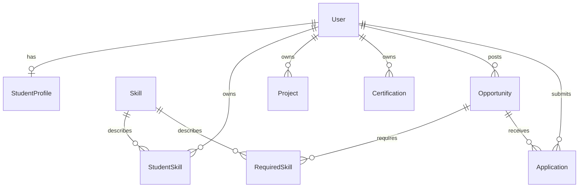
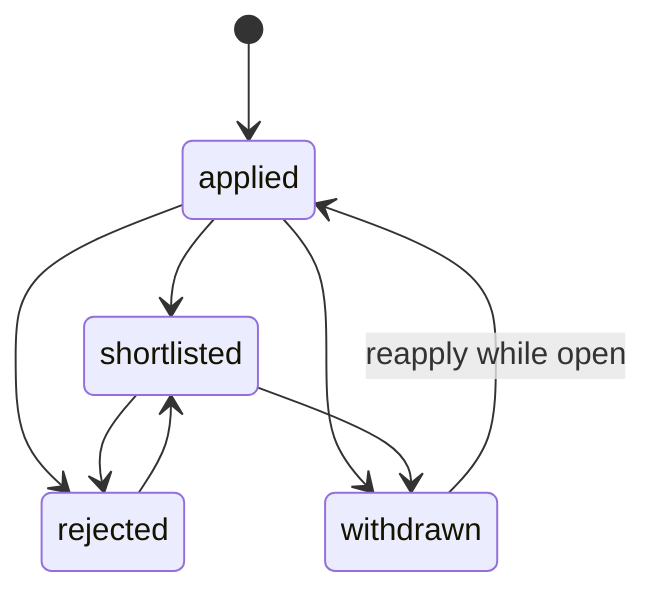

# Architecture

Django templates and vanilla JavaScript render server-side forms and role-specific dashboards. `accounts` owns the Sprint 1 domain models and views, the Sprint 2 `Application` model and workflow, and thin ORM adapters in `accounts.matching`. The independent `matching` package contains only frozen dataclasses and pure Python scoring and ranking functions; it has no Django or HTTP dependency. `skills.services` checks catalogue names. Server-side role and object ownership checks protect changes. SQLite is used locally; settings support PostgreSQL but it has not been verified.

## Matching formula

For each required skill, the student's proficiency `s` is zero when absent, the minimum level is `m` (1-4), and the requirement weight is `w` (1-100 in the database). A skill is matched when `s >= m` with credit 1, improvable when `0 < s < m` with credit `s/m`, and missing when `s == 0` with credit 0. Input validation rejects levels outside 0-4, minimums outside 1-4, non-positive weights, and duplicate skill IDs.

The overall score is `100 * sum(w * credit) / sum(w)`, calculated with `fractions.Fraction` and rounded to an integer with half-up rounding. An opportunity without requirements is unscored (`None`). Each skill contribution is the exact fraction `100 * w * credit / sum(w)` and is displayed to one decimal place. Displayed contributions can differ from the rounded integer total only because of rounding.

Worked example: two equally weighted skills, one matched and one at level 1 with a minimum of 4, produce credits 1 and 1/4. The total is `100 * (1 + 1/4) / 2 = 62.5`, rounded half-up to 63. The displayed contributions are 50.0 and 12.5 points.

Ranked applicants sort by score descending, then earlier application time, case-insensitive applicant name, and stable application ID. Unscored applicants appear after scored applicants.

## Opportunity availability and applications

`Opportunity.objects.visible()` excludes soft-removed records; `is_open()` also requires a published status and deadline on or after Django's configured local date. Expired visible opportunities are closed by a service and management command, also invoked by the list and faculty dashboard. Applications remain open through the deadline date. Historical applications to removed opportunities remain visible to their student without a link. Faculty deletion is blocked when applications exist.

Applications retain their unique student/opportunity pair, with status and last-change time. A transactional service enforces transitions and creates notifications when faculty decide; notifications are student-only. Team-gap analysis is restricted to owned academic-project and research opportunities and validates submitted members against their non-withdrawn applicants.

For each improvable or missing skill, maximum gain in an opportunity is `100 * weight * (1 - credit) / total_weight`; gains are summed as exact fractions over open visible opportunities and shown as score points, not percentages. Example: a skill with weight 3 of total 4 and credit 1/2 can add `100 * 3 * 1/2 / 4 = 37.5` points for that opportunity. Team coverage takes the highest member proficiency per required skill, then applies the same weighted scoring and half-up rounding. For two equally weighted requirements, one fully covered and one half covered, team coverage is 75. No requirements are unscored.

Proficiency is 1-4, and requirement weights are 1-100. Database constraints protect ranges and uniqueness. Matching is computed from current student skills when discovery, detail, and applicant pages render.

## Private resumes and application notes

Student profiles optionally reference a PDF resume; applications store an optional plain-text note and an independently copied PDF snapshot with a sanitised display name and size. Files use random names in `PRIVATE_MEDIA_ROOT`, not public media URLs. Authenticated download views authorise the owning student and, for active applications on visible opportunities, the owning faculty member. Replacements update database references before scheduling old-file cleanup; missing or locked files are logged. Notes and attachments do not affect matching or ranking. The score panel groups the existing engine's earned matched and partial points and remaining points; it does not change its calculation.
