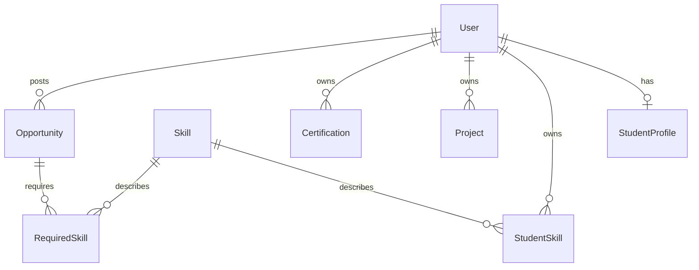

# Architecture

Django templates and vanilla JavaScript render server-side forms and role-specific dashboards. `accounts` currently owns the Sprint 1 domain models and views; the independent `skills.services` function checks catalogue names. Server-side role and object ownership checks protect changes. SQLite is used locally; settings support PostgreSQL but it has not been verified.

Proficiency is 1–4, and requirement weights are 1–100. Database constraints protect ranges and uniqueness. No matching algorithm or application workflow is implemented in Sprint 1.
